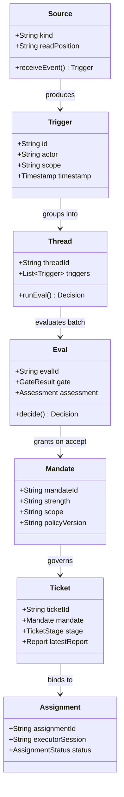

# DeepSeek SuperAgent: Architecture Reference

This document details the domain entities, lifecycle states, and orchestration mechanics derived from the DeepSeek SuperAgent design.

## 1. Domain Entities & Relationships

### Entity Specifications

1. **Source**: An event stream representing external interaction channels (e.g., GitHub, messaging bots, local developer CLI). Maintains its read position and identity filters.
2. **Trigger**: An immutable event with actor identity, target scope, and payload. Acts as the atomic unit of idempotence and auditing.
3. **Thread**: A chronologically ordered sequence of triggers. Holds subscriptions and ensures at most one evaluation pass runs on a thread at a time.
4. **Eval**: The dual-layer evaluation mechanism:
   - **Gate**: Deterministic verification checking actor credentials against policy and allowed lists.
   - **Assessment**: Model-assisted judgment determining whether proactive work is justified and matches active rules.
5. **Mandate**: An immutable authorization grant detailing permissible scope, strength (`explicit` vs. `inferred`), and policy version. A ticket cannot outgrow its mandate without human re-evaluation.
6. **Ticket**: The operational unit of work. Manages lifecycle stages, associated channels, and execution assignments.
7. **Assignment**: The binding of a ticket to an isolated execution instance (e.g., a worker subagent, workspace branch, or isolated directory).

---

## 2. Ticket Lifecycle Stages

Every ticket exists in exactly one stage based on its operational state:

| Stage Category | Condition / Sub-state | Operational Meaning |
| :--- | :--- | :--- |
| **`person / delivery`** | Input delivery failed or retrying | Awaiting system or operator reconnection |
| **`person / answer`** | An attention question is pending | Paused awaiting explicit human decision |
| **`person / review`** | Latest report is `ready` | Implementation verified; awaiting human review/approval |
| **`person / blocked`** | Implementation cannot proceed due to external blocker | Execution paused until unblocked by human |
| **`person / failed`** | Verification or execution suffered unrecoverable error | Awaiting operator guidance or retry command |
| **`working / queued`** | Worker slot pending allocation | Queued awaiting executor capacity |
| **`working / active`** | Worker is actively investigating or implementing | Background commands running or active model turn |
| **`idle / waiting`** | Turn ended without open questions; subscribed to events | Ready for subsequent human message or CI trigger |
| **`ended / dropped`** | No work required (duplicate, invalid, superseded) | Ticket terminated cleanly without spam |
| **`ended / completed`** | Pull request merged or deliverable accepted | Terminal success state |

---

## 3. Subscriptions & Fan-Out Mechanics

- **Context Subscriptions**: A ticket can subscribe to related threads (e.g., linked issues, upstream PRs) solely for information gathering. Context subscriptions grant **zero authorization** to widen the mandate.
- **Thread Follow-ups**: A follow-up message from a human on a ticket's primary thread is delivered directly to the active worker. The worker must:
  - If in-scope: Acknowledge and integrate the guidance.
  - If out-of-scope: Hand back the message to the orchestrator with an explicit 1-sentence reason (`handback`).
- **Idempotence & Deduplication**: Repeated triggers on the same thread merge into a single pending evaluation batch rather than spawning duplicate worker sessions.
