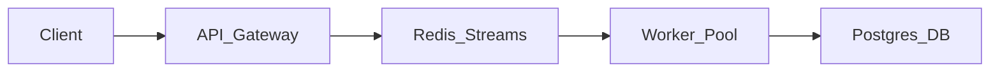

# GitHub Portfolio Analysis & Career Roadmap Planning

## 1. Intended Role & Domain
- **Primary Domain**: Career & Professional Development
- **Target Roles**: GitHub Portfolio Analyst, Project Recommendation Specialist, Career Roadmap Planner
- **Architectural Layer**: Layer 2 (Specialized Technical Skills)

## 2. Activation Conditions
- **Direct Triggers**: "github portfolio audit", "portfolio review", "github readme review", "career roadmap planner", "project recommendations", "open source contribution advice".
- **Contextual Inferences**: Engineers looking to attract recruiters, showcase open-source projects, or transition into senior technical roles.
- **Chained Predecessors**: `ats-resume-optimizer`.

## 3. Explicit Exclusions
- Do NOT use when:
  - Performing routine internal code commits or reviewing proprietary client code not destined for public portfolios.
  - Reviewing non-technical artistic portfolios.

## 4. Required Inputs & Context
- Candidate's GitHub username or repository links.
- Target career goal (e.g., Transition from QA to Full-Stack, Senior Backend Engineer, AI/ML Specialist).
- Current repository code quality, READMEs, test suites, and contribution history.

## 5. Expected Outputs & Artifacts
- GitHub Profile & Repository Audit Scorecard (README, Code Quality, CI/CD, Documentation, Architecture).
- High-Impact README Templates with architecture diagrams, quick-start instructions, and live demo links.
- Tailored Project Recommendations designed to demonstrate in-demand skills.
- 6-Month Career Growth Roadmap with milestone checkpoints.

## 6. Step-by-Step Operating Procedure
1. **Profile First Impression & Presentation Audit**:
   - Audit bio, pinned repositories, avatar, and social links.
   - Pinned repos must showcase depth and diversity: 1 flagship full-stack system, 1 deep algorithmic or system tool, 1 active open-source contribution.
2. **Flagship Repository Deep-Dive**:
   - Audit the flagship project against the Professional Portfolio Standard:
     - Clear Problem Statement & Live Demo link.
     - Architecture Diagram (Mermaid or visual flow).
     - Automated CI/CD status badge (passing tests).
     - Reproducible local setup (`docker compose up` or 1-command startup).
     - Test suite with high branch coverage.
3. **Code Quality & Hygiene Inspection**:
   - Verify commit message quality (conventional commits vs lazy "update" commits).
   - Check for sensible file structure, absence of committed secrets, and `.gitignore` hygiene.
4. **Targeted Project Recommendation**:
   - Suggest 2-3 specific, non-trivial projects that fill portfolio gaps (e.g., building a distributed task queue or a local RAG engine instead of generic to-do apps).
5. **Career Roadmap Compilation**:
   - Map a 6-month progression plan balancing skill acquisition, portfolio deliverables, and networking.

## 7. Repository Inspection & Planning Requirements
- Non-destructive inspection of repository structure and README:
  ```bash
  cat README.md 2>/dev/null || echo "No README found"
  git log -n 10 --oneline
  ```
- Preservation rule: Never recommend cookie-cutter tutorial projects (e.g. basic weather apps, simple CRUD blogs) which recruiters immediately recognize as low-effort.

## 8. Tool & Dependency Requirements
- Markdown formatting, Git CLI, GitHub CLI (`gh`).

## 9. Implementation Guidelines & Best Practices
- Every flagship repository README must follow the Five-Second Rule: within 5 seconds, an engineering manager should understand what the project does, what tech it uses, and where to click for a demo.

```markdown
# FlowQueue — Distributed, Fault-Tolerant Task Engine

[](https://github.com/username/flowqueue/actions)
[](LICENSE)

High-throughput, distributed background task processor built with Go, Redis Streams, and PostgreSQL. Handles 15,000 tasks/second with at-least-once delivery semantics and automatic dead-letter queue routing.

## 🚀 Live Interactive Demo
Try the cluster monitoring UI: **[https://flowqueue.demo.dev](https://flowqueue.demo.dev)**

## 🏛️ System Architecture


## ⚡ Quickstart (One Command)
```bash
docker compose up -d
curl http://localhost:8080/health
```
```

## 10. Error Handling & Recovery Procedures
- Missing live demo: Recommend free/low-cost serverless hosting (Vercel, Render, Fly.io, Cloudflare Pages) or embedded terminal asciinema recordings.

## 11. Security & Privacy Constraints
- Scan public repositories for committed secrets using `trufflehog` or `gitleaks` before promoting portfolios.

## 12. Verification & Testing Requirements
- Confirm that README markdown renders properly with active hyperlinks and valid Mermaid diagrams.
- Verify that recommended projects directly map to the user's targeted career aspirations.

## 13. Completion Criteria
- Portfolio audit identifies specific actionable improvements across profile and pinned repositories.
- Flagship README template provided with architecture diagram.
- Career roadmap clearly phases technical goals over 6 months.

## 14. Relevant Official References
- GitHub Profile README Guidelines (docs.github.com).
- Open Source Guides (opensource.guide).

## 15. Maintenance & Compatibility Notes
- Last audited: October 2026. Aligned with current engineering hiring standards and tech portfolio expectations.
