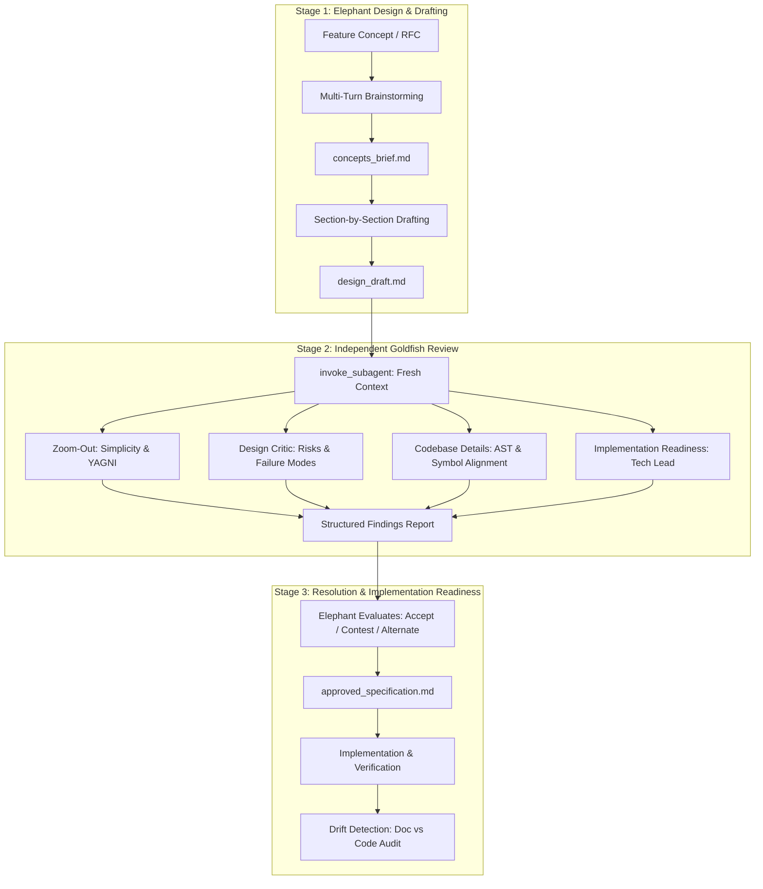

# Google Elephant Goldfish Model: Architecture Design & Independent Review

> **Attribution & Provenance**: Adapted from the official Google repository [`google/elephant-goldfish-model`](https://github.com/google/elephant-goldfish-model) (Apache-2.0 License). This skill adapts the dual-agent Elephant & Goldfish methodology for software engineering in Antigravity. It is an independent skill and not an official Google product.

## Core Principle

**"Design with an Elephant (persistent context). Review with a Goldfish (fresh, independent eyes)."**

- **The Elephant (Root Agent)**: Accumulates deep context over time—project history, user discussions, constraints, and requirements. Ideates, explores trade-offs, and drafts specifications.
- **The Goldfish (Fresh Subagent)**: Has zero conversational memory. Reviews the draft and referenced codebase artifacts with a clean slate, exposing unstated assumptions, blind spots, and architectural dead-ends.
- **The Engineer (Human Author)**: Decides architectural trade-offs, reviews findings, and signs off on specifications before implementation begins.

---

## The 3-Stage Lifecycle

---

## Critical Execution Invariants

1. **Artifact-First Delivery**: Never dump large specifications, design documents, or extensive review reports directly into the chat pane. Write them to an artifact file (`concepts_brief.md`, `design_draft.md`, or the conversation artifact directory) and provide a clickable markdown file link with a concise summary.
2. **True Independent Review**: Goldfish reviews **MUST** be dispatched to independent subagents using Antigravity's `invoke_subagent` tool. Never simulate an independent review by pretending the same conversation context has "fresh eyes." If subagents cannot be invoked, report this constraint honestly.
3. **Plain-English & Anti-Sycophancy ("No Glazing")**:
   - Write in direct, jargon-free plain English.
   - Strictly avoid ungrounded promotional adjectives (*seamless*, *robust*, *blazingly fast*, *effortless*).
   - Never flatter the user. Do not call ideas "brilliant," "great," "smart," or "spot-on."
   - Never apologize politely ("I apologize", "I am sorry"). State technical trade-offs and logic directly.
4. **Author Decides Architecture**: When a design choice has multiple defensible solutions, present up to 3 options detailing mechanisms, trade-offs, and failure conditions. The author chooses. Do not secretly default or force a subjective choice.
5. **Section Approval Gates**: When drafting specifications, pause after drafting each major section to confirm alignment before proceeding to the next section.

---

## The Goldfish Review Lenses

| Lens Persona | Target Focus | Core Inquiries |
| :--- | :--- | :--- |
| **Zoom-Out (Skeptical Architect)** | Minimalism, YAGNI, and Codebase Reuse | *Does this feature actually need to exist? Can an existing library, API, or utility solve 90% of this? Are we introducing architectural dead-ends?* |
| **Comprehension** | Clarity and Semantic Consistency | *Is the text free of ungrounded buzzwords? Can an engineer implement this without guessing intent? Are definitions ambiguous?* |
| **Design Critic** | Scalability, Security, Failure Modes | *How does this fail at 10x traffic? What happens during network partitions? Are security boundaries and secrets managed properly?* |
| **Codebase Details** | AST, Types, and Symbol Consistency | *Do the referenced class names, interfaces, and function signatures match actual source files? Does the design introduce conflicting abstractions?* |
| **Implementation Readiness** | Actionable Tech Lead Execution | *Is every step unambiguous? Does the plan omit critical schema migrations, test assertions, or error handling paths?* |

---

## Execution Workflow

1. **Brainstorming & Concept Brief**:
   - Follow interactive ideation in [references/design-methodology.md](./references/design-methodology.md).
   - Produce `concepts_brief.md`.
2. **Iterative Document Drafting**:
   - Apply the canonical specification schema in [references/specification-standards.md](./references/specification-standards.md).
   - Draft section-by-section with single-select approval gates.
3. **Independent Review Dispatch**:
   - Dispatch review personas via `invoke_subagent` as documented in [references/review-methodology.md](./references/review-methodology.md).
4. **Resolution & Acceptance**:
   - Ingest findings into the Elephant context: categorize each item as **ACCEPT**, **CONTEST** (with codebase evidence), or **ALTERNATIVE**.
   - Produce final `approved_specification.md`.
5. **Implementation Audit & Drift Detection**:
   - Compare code changes against the approved specification using the drift audit procedures in [references/verification.md](./references/verification.md).
